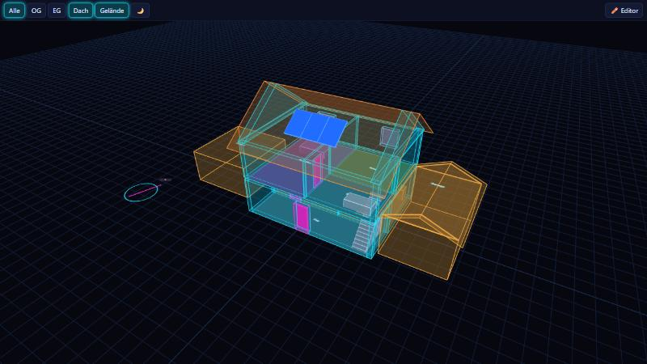

# Home Plan 3D

Zeichne deinen Grundriss (oder importiere ihn), sieh dein Haus als **leuchtendes 3D-Modell** und steuere Geräte direkt darin – als Seitenleisten-Panel und als Dashboard-Karte für Home Assistant.



## Funktionen

- **Editor** im Browser: Etagen, Räume (Rechteck/Polygon), Wände, Türen, Fenster, Möbel, Geräte, Rückgängig (Strg+Z), Raster, 2D-Plan neben der Live-3D-Vorschau.
- **3D-Ansicht**: Wände mit echten Öffnungen und Wandstärken, Treppen mit Deckenöffnung, Satteldach mit PV-Modulen, Etagen einzeln oder ganz, Neon- und Tag-Darstellung, Kompass.
- **Live-Zustände**: Lampen leuchten in ihrer Farbe/Helligkeit, Kontakte öffnen Türen und Fenster, Leistungssensoren zeigen Werte am Möbel, Tippen schaltet, langes Drücken öffnet More-Info. Raum antippen: Geräteliste mit Dimmer und Klimawerten.
- **Beides**: Geräte manuell platzieren **oder** einen Raum einem HA-Bereich zuordnen – dessen Lampen, Schalter und Rollos erscheinen automatisch im Raum.
- **Klima**: Temperatur und Luftfeuchte (und CO₂) je Raum, live am Raum; die Sensoren werden aus dem HA-Bereich des Raums erkannt oder im Editor festgelegt. Optional färbt die **Wärmekarte** die Räume nach Temperatur.
- **Gelände**: weitere Gebäude auf dem Grundstück (Garage, Scheune, Anbau …), mehrgeschossig und mit Flach-, Sattel- oder **Pultdach** (hohe Seite wählbar, zum Beispiel zum Nachbarn). Ein Pultdach-Gebäude lässt sich in **Garage und Carport** aufteilen (Stellplätze mit Breite) und mit **PV-Modulen** belegen, die als Anlage mit eigenem Leistungs-Sensor in die Energieansicht eingehen.
- **Import** aus [NeonPlan 3D](https://github.com/Mastershort/neonplan3d) (live aus dessen Websocket-API oder aus einer Backup-Datei). Es wird nur das Datenformat gelesen, kein Code übernommen.

## Installation

**HACS (empfohlen):** HACS → ⋮ → *Benutzerdefinierte Repositories* → `https://github.com/Doink9992/homeplan3d`, Typ **Integration** → *Home Plan 3D* herunterladen → Home Assistant neu starten → *Einstellungen → Geräte & Dienste → Integration hinzufügen → Home Plan 3D*.

**Manuell:** Ordner `custom_components/homeplan3d` nach `config/custom_components/` kopieren und neu starten.

Danach erscheint **Home Plan 3D** in der Seitenleiste. Mit **✏️ Editor** (nur Admins) zeichnest du; **💾 Speichern** legt den Plan in Home Assistant ab.

## Erweiterungen

Die Erweiterungen sind eingebaut. Ihre Schalter erscheinen in der Leiste, sobald sie zu deinem Plan passen (zum Beispiel eine Wetter-Entität oder ein platzierter Mediaplayer).

- **☁ Wetter** – Regen, Schnee, Gewitter mit Blitz, Nebel (optional), Wolken, Windneigung, Sonne am Tag und Mond in der Nacht, gesteuert von einer `weather.*`-Entität und `sun.sun`. Die Wetter-Entität wird automatisch gewählt oder unter `settings.weather.entity` festgelegt.
- **Live-Bildschirme** – Fernseher und Monitore (Möbeltypen `tv`, `monitor`) zeigen Cover und Farbe der laufenden App. Eigene Bild-Regeln legen fest, was bei bestimmten Zuständen erscheint: Logo, hochgeladenes Bild oder ein Kamerabild (`camera.xyz`, alle 5 s aktualisiert). Möbel anklicken, dann **🖥 Bildschirm-Regeln …**.
- **🔊 Sound** – Karten mit Cover, Titel, Transport und Lautstärke über spielenden Mediaplayern, Klangringe nach Lautstärke und Multiroom-Linien über `group_members`. Langes Drücken auf einen Mediaplayer öffnet das Schnellmenü mit Quellen und Medienbrowser.
- **⚡ Energie** – animierte Kabel mit Leistungspunkten (Farbe = Art, Tempo = Leistung) zwischen PV, Netz, Akku, Wallbox und Haus, leuchtende Solarmodule, eine Hologramm-Karte (PV, Haus, Netz, Akku, Autarkie, Gas/Wasser, Tageskurve) und Leistungskarten an Geräten. Einrichten unter **⚙ Funktionen → Energie**, auch per **Übernehmen vom Energie-Dashboard**. Als Möbeltypen helfen `meter`, `grid_point`, `battery` und `wallbox` für die Knotenpunkte der Kabel.
- **🚗 Auto** – Möbeltyp `car`: Lichtband nach Ladestand, Pin mit Ladestand, Reichweite, Ladeleistung und Verriegelung, Karte mit Schaltern für Verriegelung, Klima und Laden. Eine Entität des Autos genügt, die übrigen werden am selben Gerät gefunden (Möbel anklicken, **🚗 Auto zuordnen …**).

## Geräte verschieben und entfernen

Im Editor (↖ Auswahl) funktioniert alles mit der Maus:

- **Verschieben:** Gerät anklicken und ziehen. Ein automatisch platziertes Gerät (grau) wird dabei festgesetzt.
- **Entfernen:** anklicken und **Entf** (oder 🗑). Automatisch platzierte Geräte werden ausgeblendet; **↺ Ausgeblendete zeigen** holt sie zurück.
- **Mehrere:** auf leerer Fläche ein Rechteck aufziehen (wählt Geräte) oder mit **Umschalt+Klick** beliebige Elemente hinzufügen; dann Entf oder ziehen.
- **Liste:** das Seitenpanel zeigt alle Geräte der Etage mit Filter, ⌖-Klick springt hin, 🗑 entfernt.
- **Ganz ohne automatische Geräte:** pro Raum abschalten (Raum anklicken) oder für den ganzen Plan („Geräte aus HA-Bereichen automatisch platzieren“).
- **Strg+Z** macht jeden Schritt rückgängig.

## Plan aus NeonPlan 3D übernehmen

Editor → **⇩ Von NeonPlan 3D übernehmen**. Etagen, Räume, Wände, Öffnungen, Möbel, Platzierungen und das Dach werden umgerechnet. Alternativ **📂 Datei laden** mit einem NeonPlan-Backup. Auf der Kommandozeile: `node scripts/convert-neonplan.mjs export.json`.

## Weitere Gebäude aus dem Katasterplan

`scripts/site-from-kataster.py` liest die Gebäudeumrisse aus einem Screenshot der Liegenschaftskarte, richtet sie am Hauptgebäude aus und schreibt eine Datei, die du im Editor mit **📂 Datei laden** einfügst. Der Maßstab wird aus dem Flächenvergleich mit dem Haus geschätzt (`--scale` überschreibt ihn). Beispiel-Konfiguration: `scripts/site-config.example.json`.

```bash
python scripts/site-from-kataster.py screenshot.png site.json --config site-config.json --plan plan.json
```

## Dashboard-Karte

```yaml
type: custom:homeplan3d-card
height: 500        # Pixel
floor: 2           # optional: nur bis zu dieser Etage (0 = unterste)
theme: neon        # neon | day
show_roof: true
show_site: true
show_climate: true # Temperatur/Feuchte in den Räumen
heatmap: false     # Räume nach Temperatur einfärben
```

## Entwicklung

```bash
cd frontend && npm install && npm run build   # baut custom_components/homeplan3d/www/homeplan3d.js
python -m http.server 8765                    # dann http://127.0.0.1:8765/preview/index.html (Demo ohne Home Assistant)
pip install pytest-homeassistant-custom-component && pytest   # Backend-Tests
```

Die Vorschau lädt `preview/demo-plan.json`; mit `?plan=…` kannst du einen eigenen Plan laden.

## Weiterentwickeln

Der komplette Quellcode liegt in diesem Repo (siehe `CLAUDE.md` für Aufbau, Befehle und Release-Ablauf). Auf einem anderen Rechner: `git clone`, im Ordner `frontend` `npm install && npm run build`, fertig. Deine persönlichen Gebäudedaten liegen nicht im Repo, sondern in Home Assistant; im Editor kannst du sie mit „Plan als Datei sichern“ exportieren.

## Hinweise

- Nur Satteldächer; Walm- und Pultdächer fehlen noch.
- Der Plan liegt in `.storage/homeplan3d.plan`. Speichern dürfen nur Admins, ansehen alle Benutzer.

## Lizenz

MIT
